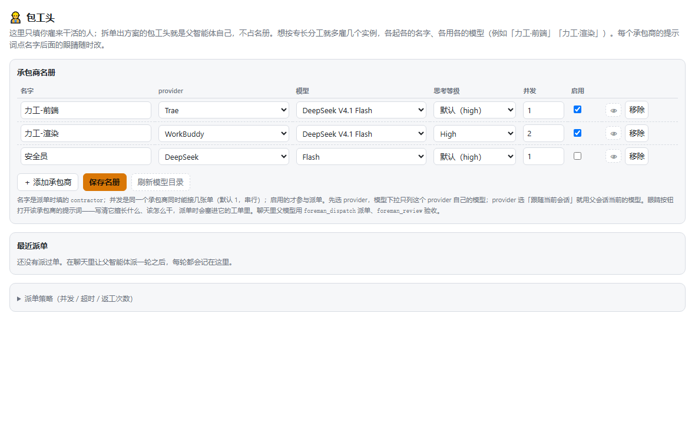

<p align="right">
  <strong>English</strong> · <a href="./README.zh.md">简体中文</a>
</p>

# Foreman · dsh-agent-foreman

> The parent splits the work; contractors do it; the parent signs off.
> No preset roles, no scripted phases: **you decide who works, and with which model**.

**Latest release: v0.4.2 (2026-11-09)** — removed the session-header 「工地」 button and
restructured both READMEs. Install and upgrade: [docs/INSTALL.md](docs/INSTALL.md).

## One prompt. A crew with its own models.

DeepSeek Harness's built-in Agent Team lets you give each teammate a name and a prompt —
but **not a model**. Real work is mixed: some of it needs an expensive model, some of it is a
two-line edit. Inheriting the parent's model for every pair of hands is both slow and expensive.

`dsh-agent-foreman` turns the current session into a **foreman**. You keep a roster of
contractors in the settings page, each with its own provider / model / reasoning effort and its
own prompt. Type `/foreman`, describe the work, and the foreman splits it into orders, dispatches
them to isolated child sessions, and reviews each result — passing or sending it back with
feedback. The four coordination tools and the shared board are all it needs; there is no separate
workflow engine and no standing system prompt.



## Why Foreman?

| Capability | What it changes |
| --- | --- |
| **Per-contractor model** | Each contractor locks its provider, model and reasoning effort at creation (`agentOptions`). This is the one thing the built-in team cannot do. |
| **Model whitelist, one source** | Every enabled contractor with an explicit route is synced into the host's subagent-model whitelist automatically. The roster is the only list you maintain. |
| **Load-aware dispatch** | Omit `contractor` and the engine picks the least-loaded contractor with spare capacity, cross-session, with a persisted rotation cursor breaking ties. Name someone only when that specific contractor must do the work. |
| **Self-contained orders** | Each order carries its task and acceptance criteria; the child cannot see the parent's context. `dependsOn` makes an order ready as soon as its own dependencies succeed — no layer barriers. |
| **Real route echo** | The board shows both the **declared** model (roster) and the **actual** model read back from the child session, and flags the row when they differ. |
| **Per-order review + rework** | `foreman_review` passes or fails each order; a failed one is re-dispatched to the same session with the feedback, up to the policy's `maxRework`. |
| **Failure blocks downstream** | A failed / timed-out / cancelled order marks its dependents `skipped`, and a skipped dependency blocks the rest of its chain instead of running on missing inputs. |
| **Settings + live board** | Responsive roster editor, policy panel, run history, and a live board (in **Settings → 包工头 → 实时工地**) polling `/api/live`. |
| **Native team mode** (experimental) | Contractors can be created as real Agent Teams members through a guarded per-call adapter, so mixed-model teammates appear in the native team tab too. |

The settings page and the runtime skill follow the host's official locale service: it switches
between English and Simplified Chinese live, without a page reload.

## Install and choose versions

**Recommended pair: DeepSeek Harness `0.2.1-rc.2` + Foreman `0.4.2`. The host is still an RC.**

| Use case | DeepSeek Harness | Foreman |
| --- | --- | --- |
| **Recommended** | **`0.2.1-rc.2`** | **`0.4.2`** |
| Re-verified preview host | `0.2.2-rc.1` | `0.4.2` |
| Older verified bridge host | `0.2.1-rc.5` | `0.4.2` |
| Minimum installable host | `>=0.2.1-rc.2 <0.3.0-0` | `0.4.2` |

The declared `engines.dsh` range also covers the `0.2.2` prerelease line. CI verifies the
specific hosts above; the installer accepts other hosts at or above the minimum. Node.js
`^22.19.0 || >=24.0.0` is required.

### From GitHub

```bash
dsh plugin add Dclef/dsh-agent-foreman
```

Install it, then **fully restart DSH** — a browser refresh alone does not reload the host plugin.

### From npm (exact version)

In the active DSH profile directory:

```bash
npm install --save-exact dsh-agent-foreman@0.4.2
# or, if the profile uses pnpm:
pnpm add --save-exact dsh-agent-foreman@0.4.2
```

A first manual install also needs `"dsh-agent-foreman"` in `dsh.profile.bundles` of the
profile's `package.json` (merge it, do not overwrite other plugins). GitHub Release also ships
a matching `.tgz` plus `SHA256SUMS.txt`. See [docs/INSTALL.md](docs/INSTALL.md) for the
offline tarball, `file:` dev install, and the pnpm hard-link re-link caveat.

## Use it

Type `/foreman` (registered at runtime through `ctx.skills.register()`) followed by the work:

```
/foreman extract GraphBlocked into shared logic; add regression tests
```

Semicolons or newlines split orders. The skill body walks the parent through
roster → split → one dispatch → review, so no standing system prompt is needed. You can also
just ask in natural language: "用包工头把这三件事分下去：……".

| Tool | Purpose |
| --- | --- |
| `foreman_roster` | List contractors with route, prompt length, concurrency cap, busy/idle state and the current policy |
| `foreman_dispatch` | Dispatch a batch of orders, wait for all of them, return the shared board |
| `foreman_review` | Pass / fail each order; a failed one is re-dispatched with feedback |
| `foreman_status` | Re-read a board; omit `runId` for the latest one in this session |

Members also report through `foreman_report`, the self-report recovery tool.

### The roster

A contractor is a name, an optional role (a lightweight trade label for routing, not a fixed
persona), an optional prompt, a provider, a model, an effort level and a concurrency cap.
**Leave the provider on "follow the current session" and the child simply runs on whatever model
the parent session is using.** To use a different model, pick the provider first — the model
dropdown is derived from it and only lists that provider's models. The minimal setup is a single
力工 (laborer); add more instances for specialties, and optionally a 安全员 (safety officer)
to review and reject. The foreman (parent agent) is never in the roster.

Settings collapses policy behind "派单策略"; each contractor has a responsive group with readable
model/effort controls, a full configured-route summary and an Edit prompt button. That prompt is
prepended to every order the contractor receives.

### Dispatch notes

- `orders[].task` **must be self-contained** — the child cannot see the parent's context.
- `orders[].contractor` accepts a contractor **name or id**, or a `role` trade label; name/id
  matching takes precedence. An unknown selector reports an error instead of silently reassigning.
- **Omit `contractor` by default.** Candidates with spare capacity come first, then the least
  loaded one; a rotation cursor only breaks ties, and load is **cross-session**. The cursor
  persists in `<data dir>/rotate-cursors.json` across restarts. Writing `contractor: "力工"` on
  every order bypasses load balancing and serializes the work — do that only when the roster has a
  single enabled contractor.
- `orders[].dependsOn` references orders in the same batch only. Failure, timeout or cancellation
  blocks downstream work as `skipped`; `waitSeconds` caps the whole batch and unfinished orders
  are aborted rather than reported done.
- Global concurrency defaults to **4** (max **8**); each contractor has its own cap (default 1).
  In native team mode, one member's inbox is always serialized — add roster members for
  independent parallel work.

## How it works

1. `/foreman` (or a natural-language request) activates the skill. The parent reads
   `foreman_roster` and splits the goal into self-contained orders with acceptance criteria.
2. One `foreman_dispatch` call sends the batch. The engine assigns contractors by live load,
   resolves dependencies, and starts each order in an isolated child session on that
   contractor's locked model route.
3. Before work is delivered in team mode, the handshake completes and the **actual** request
   configuration is verified; declared vs actual models are echoed on the board.
4. Children return a `foreman_report` with run/attempt tokens; the parent gets one shared board.
5. `foreman_review` passes or fails each order; a fail re-dispatches with feedback up to
   `maxRework`, reusing the same session so the member keeps its context.
6. Run snapshots are written atomically under `runs/`. After a restart they can be queried and
   reviewed, but interrupted work is **never** auto-resumed or silently re-dispatched.

## Configuration

Defaults work without extra setup. The settings page (or `roster.json`'s `policy`) controls:

| Field | Default | Meaning |
| --- | --- | --- |
| `concurrency` | 4 | Contractors working at once (1–8); the per-instance cap lives in the roster |
| `timeoutSeconds` | 900 | Wall-clock cap per order |
| `maxRework` | 1 | How many times an order may be sent back |
| `maxDepth` | 1 | Whether a child may dispatch further children |
| `provider` | `spawn` | Which subagents provider to use (`spawn` / `fork` / `cursor`) |
| `teamMode` | on for new policies | Create real Agent Teams members; saved policies are preserved |

**Whitelist sync**: every enabled contractor with an explicit provider+model is collected into
the host whitelist at startup, after saving the roster, and on demand via
`POST /api/whitelist/sync`. When no contractor declares an explicit route the host configuration
is left untouched (an empty list makes the host throw). It applies to **new sessions only** —
open a new session after changing the roster. A failed sync only logs, never blocks dispatch.

## Boundaries

- One foreman leads one dispatch round at a time; a batch is capped by `waitSeconds`.
- State is file-backed under `%LOCALAPPDATA%/dsh-agent-foreman/` (Windows) or
  `<baseDir>/data/dsh-agent-foreman/` elsewhere. `roster.json` stores contractors and policy;
  snapshots live in `runs/`, full delivery text in `artifacts/`. A corrupt roster is treated as
  empty and logged, never blocking startup.
- Every HTTP route accepts same-origin, loopback requests only; cross-site calls get 403.
  The roster stores provider/model/effort names — never credentials. Contractors run in their own
  child sessions and inherit DSH's effective sandbox.
- Native team mode relies on a **guarded per-call** internal adapter because the host does not
  publicly forward `agentOptions`. It is re-verified against `0.2.1-rc.5` / `0.2.2-rc.1`, never
  modifies the host ASAR or global model, and fails visibly on incompatible hosts. Arbitrary
  future host versions are not guaranteed compatible.

## Compared to

| | Agent Team (built-in) | dsh-agent-teams | Foreman |
| --- | --- | --- | --- |
| Per-member model | no | no | **yes** — `agentOptions` locked at creation |
| Cross-round memory | no | yes — previousResult | yes — history in prompt |
| Native team tab | yes | yes | yes — shared tasks |
| Self-report recovery | no | yes — update_task | yes — `foreman_report` |
| Real route echo | no | no | **yes** — declared vs actual model |
| Whitelist sync | no | no | **yes** — roster is the single source |
| Dep scheduling + failure block | no | yes — DAG | yes — ready scheduling + skipped |
| Rework loop | no | manual | yes — auto with feedback |
| Settings page | yes | no | yes — roster + model catalog |

**Key difference**: Foreman's **per-member model selection + real route echo** is unique.
dsh-agent-teams excels at full task DAG (claim/attempt/quality gates) for complex multi-phase
projects; Foreman focuses on **model-based dispatch and per-order review** with fewer tools
(4 + self-report, vs 14) and faster onboarding.

## Changelog

### 0.4.2 (2026-11-09)

- **Removed the session-header 「工地」 button and its popup panel** (and its private helpers) from `lib/client.js`; the settings-page live board and `/api/live` are unchanged.
- **READMEs restructured** after dsh-agent-teams: language switch, capability table, install/compatibility matrix, how-it-works, configuration, boundaries — keeping only Foreman's real features.
- **154 tests pass** (2 optional host/browser contract tests skipped without env vars).

### 0.4.1 (2026-11-07)
- **DSH 0.2.2-rc.1 compatibility audit**: no breaking change in the host APIs this plugin uses.
  The internal native-team bridge is re-verified against 0.2.2-rc.1.
- **Forward-compatible provider discovery**: `readSubagentProviders` prefers the public
  `subagents.list()` added in 0.2.2-rc.1; older hosts fall back to the Map / `getProvider`.
- **Stronger `engines.dsh`**: explicitly covers the `0.2.2` prerelease line under both standard
  semver and the host's `includePrerelease: true` check.
- **157 tests pass** (155 pass, 2 optional host/browser contract tests skipped without env vars).

### 0.4.0 (2026-10-31)
- Real native mixed-model teammates, verified routing, per-member serialization, responsive
  settings, loaded-runtime markers; 151 tests pass with installed-host and Chrome checks.

### 0.3.0 (2026-10-29)
- Load-aware cross-session dispatch, persisted rotation cursor, busy/idle in `foreman_roster`,
  corrected tool/skill wording, rework reuses the session.

### 0.2.0 (2026-10-28)
- Self-member system, cross-round memory, `foreman_report`, real route echo, whitelist sync,
  dependency-ready scheduling, snapshot recovery, roster roles.

### 0.1.0
- Initial release: roster management, dispatch engine, board, settings page.

## Development

```bash
npm install --ignore-scripts
npm test
```

`test/harness.test.mjs` runs the real host half against a fake host, so no DSH instance is
needed. Set `DSH_HOST_ASAR` for installed-host contract tests and `DSH_BROWSER_EXE` for Chrome
responsive roster/save tests.

## License

[MIT](./LICENSE)
