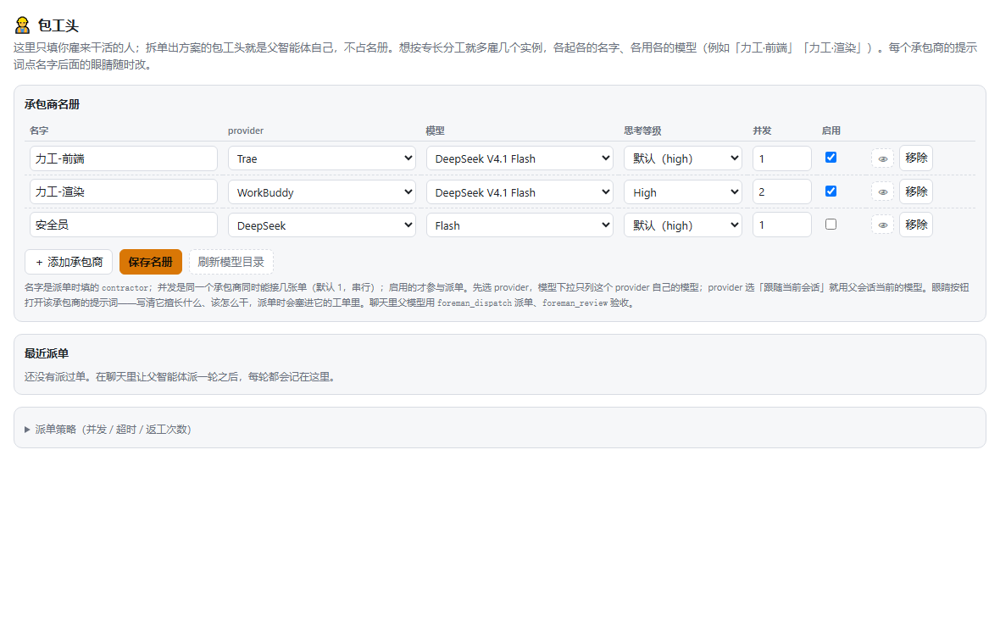

<p align="right">
  <a href="./README.md"><strong>English</strong></a> · <strong>简体中文</strong>
</p>

# 包工头 · dsh-agent-foreman

> 父智能体派单，子智能体干活，父智能体按验收清单逐单独立签收。
> 不预置角色、不写剧本：**谁干活、用什么模型，由你把关**。

**版本兼容（0.5.0）：** 已包含 DSH **0.2.2-rc.2** 兼容修复，保留 **0.2.2-rc.1** / **0.2.1-rc.5** 的原有兼容路径；宿主仍是 RC，未调用真实模型完成端到端验收。声明的 `engines.dsh` 为 `>=0.2.1-rc.2 <0.3.0-0 || >=0.2.2-0 <0.3.0-0`，Node.js 需 `^22.19.0 || >=24.0.0`。旧版本界面及安装记录仅适用于当时的包。

**定位变化（重要）**：DSH 现已内置**原生多 Agent 编队**（持久具名 teammate、peer 消息、共享任务板、Web 面板）。本插件**不再宣称「补齐编队空缺」**，而是架在原生能力之上的一层薄编排：**按模型派单 + 逐单独立验收 + 返工闭环**。两者并存互补，不互相替代；原生编队管「一支队伍怎么协作」，包工头管「这批活分别用哪个模型、谁逐单签收」。若你只需要具名队友协作，请直接用原生编队。

**安装入口**：[优先从 GitHub / npm 安装](#安装与版本选择)。[让 AI 帮你装](#让-ai-帮你安装复制下面这段提示词)。

---

## 一句话派单，一支各用各模型的队伍

DSH `0.2.2-rc.2` 的原生具名子智能体已支持创建时选择模型。包工头把 provider、模型、思考等级和提示词保存成承包商名册，再按实时负载派单，逐单验收并把返工交回同一成员。

`dsh-agent-foreman` 把当前会话变成**包工头（父智能体）**：你在设置页维护一份承包商名册，每人有自己的 provider / 模型 / 思考等级和自己的提示词。敲 `/foreman` 把活一说，包工头拆成工单、派给各自独立的子会话，再逐单验收——合格通过，不合格带反馈打回。全程只用四个协调工具加一块共享看板，不需要独立的工作流引擎，也不挂常驻系统提示词。



## 为什么用它（0.5.0）

| 能力 | 带来什么 |
| --- | --- |
| **每个承包商可选模型** | 在名册保存 provider / 模型 / 思考等级，创建成员时传入 `agentOptions`，交付时核对实际路由。 |
| **白名单只维护一处** | 启用且配了显式路由的承包商自动汇总进宿主子智能体模型白名单；名册是唯一来源。 |
| **按实时负载派单** | 省略 `contractor` 时，引擎在还有空位的人里挑在跑张数最少的，负载跨会话可见，落盘轮转游标只用来打破平局。 |
| **工单自足 + 验收清单** | 每张工单自带任务、验收标准与 `checklist`；子智能体看不到父会话上下文。看板把清单摆给父智能体逐项核对。 |
| **写入范围提示（新）** | 工单可写 `writeScopes`（与原生任务板同形的 workspace 相对前缀）。并行工单范围重叠时看板挂**软警告**；这只是提示，**不隔离文件、不授予写权限、不阻止派单**。 |
| **独立验收（新）** | `foreman_review` 逐单 pass / fail；**做的人不自己签收**，pass/fail 都记 `reviewedBy=foreman`。fail 必须给具体 `feedback`，否则拒绝——避免「没理由白跑一轮返工」。 |
| **真实路由回显** | 看板同时显示**声明模型**（名册配置）和**实际模型**（子会话读回），不一致就标红。 |
| **返工闭环** | fail 带反馈重派给同一会话（保留上下文），次数由 `maxRework` 控制。 |
| **失败阻断下游** | 工单失败 / 超时 / 取消后下游标 `skipped` 并递归阻断，不在缺产物时硬跑。 |
| **设置页 + 实时看板** | 响应式名册编辑、策略折叠区、派单历史，以及**设置 → 包工头 → 实时工地**（轮询 `/api/live`）。 |

设置页与运行时 skill 跟随宿主官方 locale 服务，中英文实时切换，无需刷新页面。

## 验证范围（诚实说明）

- 离线回归包含新旧宿主严格模拟、全链路派单、模型隔离、取消收尾、纯函数与快照恢复。真实宿主 ASAR 契约和 headless Chrome 测试需配置对应路径；未配置时会明确跳过。**未调用真实模型、未启用真实原生编队**。
- 0.5.0 新增行为由 `test/optimization.test.mjs` 覆盖：写入范围规范化、重叠检测、验收清单注入、fail 必填 feedback、独立签收标记、看板输出。
- **未做**：真实多会话并发派单、真实浏览器响应式交互、真实原生编队启用状态下的端到端、跨 DSH 未来版本兼容性。`0.2.2-rc.2` 使用公开具名子智能体接口；旧宿主保留单次调用作用域的内部兼容桥，**不保证任意未来宿主版本兼容**。
- 不承诺 Token 节省、不承诺固定提速、不承诺「模型选择一定落到子会话」（看板用声明/实际回显来自查）。

## 安装与版本选择

**0.5.0 已包含 DSH `0.2.2-rc.2` 适配；宿主仍是 RC，安装后必须彻底重启 DSH。**

| 场景 | DeepSeek Harness | 包工头 |
| --- | --- | --- |
| 当前发布适配 | `0.2.2-rc.2` | `0.5.0` |
| 原有支持范围 | `0.2.1-rc.2` | `0.5.0` |
| 已复验预览宿主 | `0.2.2-rc.1` | `0.5.0` |
| 早期已验证兼容桥宿主 | `0.2.1-rc.5` | `0.5.0` |
| 最低可安装宿主 | `>=0.2.1-rc.2 <0.3.0-0` | `0.5.0` |

`engines.dsh` 显式覆盖 `0.2.2` 预发布线；CI 验证上表具体宿主，安装器接受不低于最低版本的其它宿主。

### 从 GitHub 安装

```bash
dsh plugin add Dclef/dsh-agent-foreman
```

装好后**彻底退出并重新启动 DSH**——只刷新网页不会重新加载宿主插件。

### 从 npm 精确版本安装

在**当前 DSH profile 目录**执行：

```bash
npm install --save-exact dsh-agent-foreman@0.5.0
# profile 用 pnpm 时：
pnpm add --save-exact dsh-agent-foreman@0.5.0
```

首次手动安装还要在 profile 的 `package.json` 里把 `"dsh-agent-foreman"` 合并进 `dsh.profile.bundles`（不要覆盖其它插件）。GitHub Release 另附同名 `.tgz` 与 `SHA256SUMS.txt`。离线包、`file:` 开发安装、pnpm 硬链接重链坑见 [docs/INSTALL.md](docs/INSTALL.md)。

## 生效说明

- **安装或更新后必须完全退出并重启 DSH**：宿主半部 `lib/index.js` 与设置页插件都只在启动时装配，重启前改动不生效。
- 重启后**新建会话**：白名单同步只影响新会话，改完名册要开新会话才生效。
- 打开 **设置 → 包工头** 维护名册；右栏「实时工地」看本轮工单状态。
- 面板渲染在浏览器端，须重启后在真实会话里实测；上面截图只记录当时可见的设置页状态，不代表跨版本兼容或真实团队交互已验证。

## 让 AI 帮你安装（复制下面这段提示词）

```text
请帮我安装 DeepSeek Harness 的「包工头」插件 dsh-agent-foreman@0.5.0：

1. 确认我的 DSH 版本符合 >=0.2.1-rc.2 <0.3.0-0，并确认目标 profile。
2. 优先用 dsh plugin add Dclef/dsh-agent-foreman，或在该 profile 目录执行
   npm install --save-exact dsh-agent-foreman@0.5.0（pnpm 用 pnpm add）。
   首次手动安装要把 "dsh-agent-foreman" 合并进 dsh.profile.bundles，不要覆盖其它插件。
3. 核实安装版本为 0.5.0；不要声称成功除非读到版本号。
4. 提醒我完全退出并重启 DSH、新建会话；只刷新网页不会重新加载宿主插件。
5. 不要修改宿主 ASAR、不要切全局模型、不要编造 CLI 命令。失败时给出原始错误。
```

## 用起来

`/foreman`（优先注册原生命令，宿主无 commands 服务时退回 `ctx.skills.register`）后面直接跟任务：

```
/foreman 把 GraphBlocked 抽成共享逻辑；给新逻辑补回归测试
```

分号或换行分段，一段一张工单。skill 正文规定四步：看名册 → 拆单（补齐背景/文件/验收/`writeScopes`/`checklist`）→ 一次 `foreman_dispatch` → 逐单 `foreman_review`，用时注入一次，不常驻系统提示词。也可以直接说："用包工头把这三件事分下去：……"。

| 工具 | 作用 |
| --- | --- |
| `foreman_roster` | 看名册：有哪些承包商、什么模型、提示词多少字、并发几张单、忙闲状态与当前策略 |
| `foreman_dispatch` | 派一轮工单，等全部落定，返回看板（含每单交付摘要） |
| `foreman_review` | 逐单 pass / fail；fail 且还有额度就带着反馈重派给同一个人 |
| `foreman_status` | 回看某一轮看板；省略 runId 取本会话最近一轮 |

成员另用 `foreman_report` 自报交付，作为产物回收的兜底。

### 名册

承包商 = 名字 + 可选岗位（`role`，只用于派单路由，不是固定角色体系）+ 提示词 + provider + 模型 + 思考等级 + 并发上限。**provider 选「跟随当前会话」时，子智能体直接跑父会话当前的模型**。最简形态只有一个人：力工（干活）；想要专长就多雇几个实例、各写各的提示词，另可加一个安全员（挑错，可选）。包工头（父智能体）不占名册。

### 派单参数要点

- `orders[].task` **必须自足**：子智能体看不到父会话的任何上下文。
- `orders[].writeScopes`（新）workspace 相对前缀，仅提示；并行重叠会在看板挂软警告，不隔离、不阻止派单。
- `orders[].checklist`（新）验收清单；父智能体逐项核对，**做的人不自己签收**。
- `orders[].contractor` 可写名字 / id / 岗位名；**默认就该省略**，按实时负载挑人，只有名册里确实只有一个启用承包商时才写死「力工」。
- `orders[].dependsOn` 只能引用本轮内的工单；失败 / 超时 / 取消会把下游标 `skipped` 并递归阻断；`waitSeconds` 是整轮墙钟上限，到点中止没跑完的工单，不返回假的「全部完成」。
- 总并发默认 **4**（上限 8），每人还有自己的并发上限（默认 1）。

## 工作原理

1. `/foreman` 激活 skill。父智能体读 `foreman_roster`，把目标拆成带验收标准、写入范围与验收清单的自足工单。
2. 一次 `foreman_dispatch` 派出整批。引擎按实时负载分人、解析依赖，在各自独立的子会话里用该承包商锁定的模型路由开工。
3. 团队模式（可选）在投递工单前完成握手，核对**实际**请求配置；看板回显「声明 / 实际」模型。
4. 子智能体用带 run/attempt 令牌的 `foreman_report` 回报；父智能体拿到一块共享看板，看板上附验收清单与写入范围重叠警告。
5. `foreman_review` 逐单打分；**父智能体按清单独立签收**，fail 带具体反馈重派同一会话，次数受 `maxRework` 限制。
6. 运行快照原子写入 `runs/`。重启后可查询、验收已落定的看板，但**中断的工作绝不自动续跑或偷偷重派**。

## 配置

| 字段 | 默认 | 说明 |
| --- | --- | --- |
| `concurrency` | 4 | 同时在场的承包商数（1–8）；单人的上限在名册里按人设 |
| `timeoutSeconds` | 900 | 单张工单的墙钟上限 |
| `maxRework` | 1 | 每张工单最多被返工几次 |
| `maxDepth` | 1 | 子智能体还能不能再派子智能体 |
| `provider` | `spawn` | 走哪个 subagents provider |
| `teamMode` | 新配置默认开 | 创建真实原生团队成员；已保存的策略不被覆盖。还需打开 DSH 当前会话的「启用智能体团队协作」 |
| `teamFallback` | 关 | 团队服务缺失或宿主会话开关关闭时，显式退回普通子会话；成员已创建但派单失败不会静默降级 |

**白名单同步**：启用且配了 provider+model 的承包商在插件启动时、保存名册后自动汇总进宿主白名单，也可 `POST /api/whitelist/sync` 手动触发。没有任何显式路由时**不动**宿主原配置。只影响**新会话**。同步失败只记日志，不阻断派单。

## 边界

- 一个包工头同时只带一轮派单，整批受 `waitSeconds` 限制。
- 状态落盘：Windows 在 `%LOCALAPPDATA%/dsh-agent-foreman/`，其它平台在 `<baseDir>/data/dsh-agent-foreman/`。`roster.json` 存名册与策略，快照在 `runs/`，完整交付正文在 `artifacts/`。名册坏了会被当成空名册并记日志，不阻断启动。
- 所有 HTTP 接口只接受同源、回环地址请求，跨站一律 403。名册只保存 provider / 模型 / 思考等级等配置，不保存任何密钥。承包商在独立子会话里跑，沙箱沿用 DSH 当前生效的一套。
- **writeScopes 只是提示**：Bash、formatter、代码生成器与直接外部写入都能绕过；Lead 必须复核最终 diff。
- 原生团队模式依赖宿主具名子智能体与任务板接口；已对 DSH `0.2.2-rc.2` 的真实 ASAR 契约复验，不改宿主 ASAR、不切全局模型，宿主不兼容时明确失败；不保证任意未来宿主版本都兼容。

## 与其它方案的区别

| | 原生多 Agent 编队 | 内阁模式 | 文渊阁 dsh-ai-team | 包工头 |
| --- | --- | --- | --- | --- |
| 定位 | 宿主内置：持久 teammate / 消息 / 共享任务板 | persona 预设 + 右栏面板 | 独立三栏工作台 + append-only 账本 | 架在编队之上的**模型派单 + 逐单验收**薄层 |
| 成员可选模型 | ✗ `spawn_teammate` 不选模型 | ✓ 官职模型选择 | ✓ 成员模型下拉 | **✓** `agentOptions` 创建时锁定 |
| 独立验收 | ✗ | 大理寺卿 / 左都御史（persona） | **✓** 做的人不验收 + QA 硬门禁 | **✓** 父智能体按 checklist 独立签收 |
| 写入范围提示 | ✓ `writeScopes`（仅提示） | — | — | ✓ 同形软警告（仅提示） |
| 返工闭环 | ✗ | — | 退回 | ✓ 带反馈自动重派 |
| 真实路由回显 | ✗ | — | — | **✓** 声明 vs 实际模型 |
| 工具数量 | 9 个 Team 工具 | 标准模式工具 | 自建命令集 | 4 + 自报 |

**核心差异**：原生编队解决「一支队伍怎么协作」，包工头只补两件它没做的事——**按模型拆单**和**逐单独立验收 + 返工**。内阁模式偏 persona 与可视化，文渊阁偏完整持久化任务系统；三者都比包工头重，可按项目规模选用，不要叠加同一份活。

## 版本说明

### 0.5.0（2026-11-13）

- **重新定位**：DSH 已内置原生多 Agent 编队，README / skill / 工具描述不再宣称「补齐编队空缺」，改为「与原生编队并存互补」。
- **写入范围提示**：新增 `writeScopes`（与原生任务板同形），规范化、并行重叠检测、看板软警告；明确不隔离文件、不授予写权限。
- **独立验收**：新增 `checklist` 验收清单、`reviewedBy=foreman` 签收标记、fail 必填 `feedback`；看板把清单与重叠警告摆给父智能体。借鉴文渊阁「做的人不验收」，但只做提示层、不引入 QA 硬角色。
- **团队开关可见**：设置页标出宿主原生团队接口与当前会话开关要求，避免把 DSH 总开关和 Foreman 自身团队模式混淆。
- **显式自动兜底**：新增 `teamFallback`；仅在团队服务缺失或宿主会话开关关闭时退回普通子会话，成员已创建但派单失败仍严格报错。
- **DSH 0.2.2-rc.2 适配**：普通激活改用平铺参数，具名成员与任务归属使用新版公开接口，取消只隔离被取消成员。
- **文档诚实化**：置顶版本兼容、验证范围与不承诺、生效说明、AI 安装提示词、与原生编队 / 内阁 / 文渊阁对照。参考 [dsh-cabinet-mode](https://github.com/luodaoyi/dsh-cabinet-mode) 与 [dsh-ai-team](https://github.com/suifei/dsh-ai-team) 的写法。
- **201 项测试：198 通过、0 失败、3 跳过**：离线套件覆盖兼容路径、显式团队兜底、宿主能力探针，以及需要真实 ASAR / 浏览器路径的门控契约。未调用真实模型。

### 0.4.2（2026-11-09）
- 移除会话头「🏗 工地」按钮及其弹层；两份 README 按 dsh-agent-teams 结构重写。

### 0.4.1（2026-11-07）
- DSH 0.2.2-rc.1 兼容性核验；provider 发现改公开接口；`engines.dsh` 更稳。

### 0.4.0（2026-10-31）
- 真实原生多模型编队、路由核验、同成员串行交付、响应式名册、运行构建标识。

### 0.3.0（2026-10-29）
- 按实时负载跨会话派单、轮转游标持久化、`foreman_roster` 显示忙闲、返工复用会话。

### 0.2.0（2026-10-28）
- 自建成员系统、跨轮记忆、`foreman_report`、真实路由回显、白名单同步、依赖就绪调度、快照恢复。

### 0.1.0
- 初始版本：名册管理、派单引擎、看板、设置页。

## 开发

```bash
npm install --ignore-scripts
npm test
```

默认测试用假宿主跑真实插件（`test/harness.test.mjs`），不需要启动 DSH。设置 `DSH_HOST_ASAR` 可跑已安装宿主的只读契约测试，设置 `DSH_BROWSER_EXE` 可跑 Chrome 响应式名册与保存交互测试。

## License

[MIT](./LICENSE)
